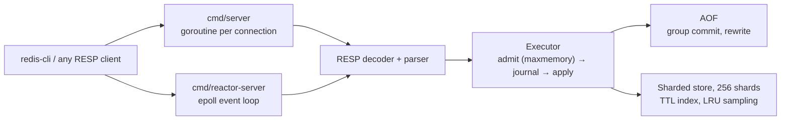

<p align="center">
  
</p>

<h1 align="center">🥕 Carrot</h1>

<p align="center">
  <b>A Redis-inspired in-memory server in Go, built to learn how Redis really works.</b><br/>
  RESP protocol · epoll event loop · crash-safe AOF with group commit · TTLs · LRU eviction
</p>

<p align="center">
  <a href="https://github.com/shivam-pathak9/carrot/actions/workflows/ci.yml"></a>
  
  
  <a href="LICENSE"></a>
</p>

Carrot speaks the Redis wire protocol, so `redis-cli` and `redis-benchmark` work
against it out of the box. I built it to understand the hard parts of a
database server for real: durability, concurrency models, memory limits, and
what it costs to get them right.

It is not a Redis replacement. It has strings and lists, no auth, and it is
honest about both (see [Limitations](#limitations)).

## See it work

<p align="center">
  
</p>

That is a real, typed terminal session (no mock-up): a bash shell in a PTY,
recorded with [`scripts/record_session.py`](scripts/record_session.py) and
rendered with [`agg`](https://github.com/asciinema/agg). It covers expiry, a `kill -9` crash with recovery from the AOF, and both memory-limit
policies.

### And at scale

<p align="center">
  
</p>

[`make demo-scale`](scripts/demo_scale.py) holds 10,000 simultaneous
connections on both servers (every client checks its own data), `kill -9`s a
server while 200 clients write under `appendfsync always` and verifies no
acknowledged write is lost, and floods a 50 MB limit with a million keys under
each policy. It takes about a minute. The throughput it prints is bounded by the
single Python client, so read it as a correctness demo, not a benchmark.

## Quick start

You need Go 1.26+ and, for `make demo`, `redis-cli`. AOF persistence needs Linux
(or WSL).

```bash
git clone https://github.com/shivam-pathak9/carrot && cd carrot
go run ./cmd/server -host 127.0.0.1 -port 16379      # goroutine-per-connection
go run ./cmd/reactor-server -host 127.0.0.1 -port 16380   # Linux epoll event loop

redis-cli -p 16379 SET greeting "Hello, Carrot!"
redis-cli -p 16379 GET greeting
```

Useful flags (both binaries):

```bash
-aof-sync always|everysec|no        # durability vs speed, default everysec
-aof-enabled=false                  # ephemeral, also needed on non-Linux
-maxmemory 100mb -maxmemory-policy allkeys-lru
```

The default bind is `0.0.0.0` with no auth or TLS, so use loopback unless you
are on a trusted network.

## Architecture



## What it does

| Area | Details |
|---|---|
| Protocol | RESP framing with bounded decoding, pipelining, inline commands |
| Strings | `SET` (`EX`/`PX`/`PXAT`), `GET`, `DEL`, `TTL`, `EXPIRE`, `PEXPIREAT`, `PING` |
| Lists | `LPUSH` `RPUSH` `LPUSHX` `RPUSHX` `LPOP` `RPOP` `LLEN` `LRANGE` `LINDEX` `LSET` `LTRIM` `LREM` `LINSERT` `LPOS` `LMOVE` `RPOPLPUSH` |
| Expiry | Lazy on access, plus Redis-style sampled active expiry over a per-shard TTL index |
| Persistence | Append-only file, group commit, three sync policies, background rewrite, crash recovery |
| Memory limit | `-maxmemory` with `noeviction` or approximated `allkeys-lru` |
| Two servers | Goroutine-per-connection and a hand-written Linux epoll reactor sharing one command core |

## The interesting parts

**Group-committed AOF.** With `appendfsync always`, concurrent writes are
batched (up to 64 commands or about 250µs) and covered by one `fsync` instead of
one each. Writes are appended before they are applied, so a failed append never
changes memory. Relative TTLs are stored as absolute deadlines so a restart does
not give keys a second life.

**Background AOF rewrite without `fork`.** Go can't safely fork a runtime, so
`AOFREWRITE` takes a brief barrier to copy a snapshot, serializes it in a
worker while writes go to both the live log and a delta file, then swaps the
files atomically. The cost is temporary memory proportional to the dataset.

**Real LRU eviction.** Every write goes through one choke point that tracks an
estimate of memory. When over the limit, `allkeys-lru` samples 5 random keys,
evicts the oldest, and journals a `DEL` first so recovery reproduces it. Refused
writes under `noeviction` return `-OOM` and are never journaled.

**Two concurrency models, one core.** The goroutine server is simple. The
reactor uses non-blocking sockets and epoll, with its own buffering, partial
writes and `EPOLLOUT` handling. Both share the parser, executor, store and AOF,
so they can be compared fairly.

**Active expiry that actually samples.** Each pass picks random keys from a
per-shard TTL index, repeats while more than 25% are expired, and is bounded by
a 25ms budget, with deletes journaled before removal.

## Performance, honestly

All numbers are from one WSL2 machine with AOF off unless stated, so treat them
as observations, not rankings. Reproduce them with `make benchmark`.

`redis-benchmark`, 10 clients, pipeline depth 16, requests/second:

| | Goroutine | Reactor | Redis 7.0.15 |
|---|---:|---:|---:|
| SET | 125,000 | 178,571 | 588,235 |
| GET | 119,048 | 178,571 | 714,286 |

The reactor beats the goroutine server by about 1.4 to 1.8x. Redis is still 3x
to 4x faster at depth 16. A CPU profile of the reactor shows about 45% of time
in syscalls and about 13% in allocation, so the gap is mostly syscall and
per-request overhead, not the data structures. I haven't closed it yet.

The cost of durability (standard server, `SET`, 10 clients, 16 byte values):

| AOF policy | depth 1 | depth 16 |
|---|---:|---:|
| Off | 23,810 | 99,502 |
| `everysec` | 20,080 | 49,020 |
| `always` | 1,415 | 1,430 |

`always` is bound by the WSL2 disk's `fsync` latency. And the cost of the
memory limit: `SET` throughput dropped about 6% (156k to 147k rps) with no limit
configured, and `GET` was within noise. At a 1 MB limit, `noeviction` returned
`-OOM` after about 3,500 writes with every stored key still readable, and
`allkeys-lru` took 60,000 writes with zero errors and a bounded keyspace. Full
tables, profiles, and caveats are in the [LLD](LLD.md#benchmarks).

## Testing

180 tests across 9 packages, run with `-race` in CI, plus a Python network E2E
harness, a decoder fuzz run, and a `kill -9` crash harness that checks every
acknowledged write survives restart. Package coverage is 58% to 94% (see the
[LLD](LLD.md#testing)).

```bash
make check       # fmt, tests, race, coverage, vet, build
make test-e2e    # both servers over real TCP (Linux/WSL)
make demo        # the walkthrough above
make demo-scale  # 10,000 clients, crash under load, memory flood
make benchmark   # Carrot vs Redis (needs redis-server and redis-benchmark)
```

## Limitations

- Only strings and lists. No hashes, sets, sorted sets, blocking pops, pub/sub.
- No auth or TLS, and no replication.
- Linux only for AOF. `-maxmemory` bounds an estimate of key and value size,
  not the Go heap, and one command (or a 64 command batch) can overshoot it.
- A kill -9 is tested; power loss and failing disks are not.
- Lazy-expiry deletes are not journaled, so a clock moving backwards between
  crash and restart could briefly resurrect an expired key until the next rewrite.
- The reactor executes commands on one goroutine, so a slow command blocks it.

## Docs

- [HLD](HLD.md): architecture, request path, persistence, expiry and eviction,
  design trade-offs, and roadmap
- [LLD](LLD.md): package map, locking and write ordering, reactor internals,
  tests, benchmarks, contributing notes

## License

MIT. See [LICENSE](LICENSE).
